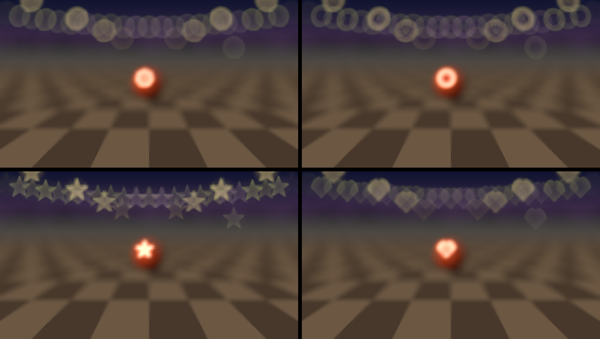

# hyacinth

> **AI-assisted project.** This codebase was created with [Claude](https://claude.com/claude-code) (Anthropic), directed and reviewed by a human author. Its behaviour is measured rather than asserted. An offline harness drives the plugin's own class in a headless GL context and checks each claim against an independent model:
>
> - **The lens:** a defocused point's disc has the thin lens's radius, linear in nearness, to 0.03 px. It carries exactly its highlight's light, within 0.4 %, for every aperture shape, profile and squeeze, and the cat's eye loses what the overlap of two circles says.
> - **The aperture and the flare:** the disc's corners are its blades, upside down in front of focus. A starburst has N spikes for even N and 2N for odd. The ghosts lie on the line through the light and the centre.
> - **Depth and focus:** a plane matches a pinhole camera's to 3e-7. The depth's edges land on the picture's, and the guided filter returns an exact linear function of the colour. A tracked subject is followed to 0.06 px RMS.
> - **Passthrough:** at zero Mix the clip comes through bit for bit, and a sharp foreground hides the bokeh behind it bit for bit.
> - **The checks can fail:** 16 negative controls and 21 one-character mutants show it.
>
> On Windows it has been loaded into **Resolume Arena 7.27.1**, and every control that can act on a still picture changed Arena's picture. It has **never been loaded into Resolume on macOS**. Full details are under [Status](#status).

Shallow depth of field, bokeh and lens flare, as an FFGL effect for [Resolume](https://resolume.com) Arena and Avenue. Give the clip a depth: a ground plane to a horizon, a radius round a point, its luma, its haze, whatever looks like the subject, its alpha, or a depth map packed beside it. Focus on a distance, a point, or a thing the tracker follows. The rest of the picture falls out of focus, and its highlights become the aperture: seven blades, a mirror lens's ring, a star or a heart. Or leave the picture sharp and add only the bokeh. Add orbs, lens flare and dirt on the glass, all the same aperture.

The name is oblique: Hyacinth Bucket insisted on "Bouquet", and bouquet is nearly bokeh.


<sub>Rendered by `hytest`, the offline harness, not captured from Resolume. Its own street, focus on the ball (Point), a flare from a Light. The defaults otherwise.</sub>



<sub>Shape: Iris (seven blades), Mirror, Star and Heart. Focus Depth 0.9 (Manual), Blur Size at its top, Bubble +0.5, at 640×360.</sub>

<!-- downloads:start -->

## Download

**[v0.1.0](https://github.com/stoatworks-labs/hyacinth/releases/tag/v0.1.0)** — prebuilt for macOS and Windows. Pick your platform:

<details>
<summary><b>macOS</b> — Universal (Apple Silicon + Intel)</summary>

| Build | Download | Size |
| --- | --- | --- |
| Universal (Apple Silicon + Intel) · .dmg disk image | [`hyacinth-0.1.0-macos-universal.dmg`](https://github.com/stoatworks-labs/hyacinth/releases/download/v0.1.0/hyacinth-0.1.0-macos-universal.dmg) | 286 KB |
| Universal (Apple Silicon + Intel) · .zip archive | [`hyacinth-macos-universal.zip`](https://github.com/stoatworks-labs/hyacinth/releases/latest/download/hyacinth-macos-universal.zip) | 239 KB |

</details>

<details>
<summary><b>Windows</b> — x64</summary>

| Build | Download | Size |
| --- | --- | --- |
| x64 · .exe installer | [`hyacinth-0.1.0-windows-x86_64-setup.exe`](https://github.com/stoatworks-labs/hyacinth/releases/download/v0.1.0/hyacinth-0.1.0-windows-x86_64-setup.exe) | 244 KB |
| x64 · .zip archive | [`hyacinth-windows-x86_64.zip`](https://github.com/stoatworks-labs/hyacinth/releases/latest/download/hyacinth-windows-x86_64.zip) | 139 KB |

</details>

All builds, checksums and release notes: [github.com/stoatworks-labs/hyacinth/releases](https://github.com/stoatworks-labs/hyacinth/releases).

macOS builds are signed and notarised and open normally. The Windows builds are unsigned, so SmartScreen warns once.

<!-- downloads:end -->

## The one idea

**A thin lens focused at one distance blurs a point at another into a disc whose radius is linear in the difference of their nearnesses, 1/distance, not their distances:**

    CoC = Blur Size × (n − n_focus)      n = nearness: 1 near, 0 at infinity

Hyacinth keeps every depth as nearness and does everything from that line, one depth per pixel, and one aperture. Everything else falls out:

- **The background's blur levels off; the foreground's does not.** Twice the focus distance away, a point already has half the blur it will have at infinity, so a wall a mile off is barely softer than one a hundred metres off. Half the focus distance away it already has as much blur as infinity has, and nearer still it keeps growing: a hand in front of the lens is a smear.
- **A defocused highlight is the aperture,** with the highlight's light spread over it: a big disc is dim and a small one bright. Highlights brighter than the clip's white come back first (Highlights), because the clip clipped them.
- **In front of focus the aperture is upside down.** The light's cone has not yet crossed, so a heart is the wrong way up and a seven-bladed disc points down.
- **Off axis the disc becomes a cat's eye.** The light must pass two round openings in the barrel that no longer line up, and loses what they cut off.
- **Over-corrected spherical aberration brightens the rim of the discs behind focus and the middle of the ones in front.** Bubble moves light within a disc, never in or out of it.
- **Chromatic aberration fringes the other way either side of focus.** Red and blue focus at a different nearness from green: magenta rims in front, green behind.
- **A sharp thing hides the blur behind it, but a blurred thing in front spreads over a sharp one.** What is in front of a pixel and what is behind it are gathered separately.
- **A starburst has a spike along each blade edge's normal, both ways.** Even counts overlap, so six blades give six spikes and seven give fourteen.
- **The ghosts lie on the line through the light and the centre,** and move against the light.

## Controls

- **Lens**
  - **Mode**: Depth of Field (the picture defocused, highlights as bokeh) or Bokeh Only (the picture left sharp, its highlights' bokeh drawn over it).
  - **Blur Size**: the CoC's radius for a nearness difference of 1, 0–8 % of the height.
- **Depth**
  - **Depth From**: Plane, Radial, Luma, Haze, Subject, Clip Alpha, Side by Side or Over Under.
  - **Plane Angle**: which way the plane comes toward the camera, 0–360°. 270° is the ground.
  - **Horizon**: where the plane meets infinity, from the frame's far edge to its near one.
  - **Radius**: how far Radial reaches infinity, 0.1–3 heights.
  - **Depth Edges**: the guided filter's radius, 0.5–8 % of the height. It snaps Haze and Subject to the picture's edges.
  - **Depth Invert**.
- **Focus**
  - **Focus**: Manual, Point or Track.
  - **Focus Depth**: the nearness in focus, for Manual.
  - **Focus X** and **Focus Y**: the point Point reads and Track grabs.
  - **Grab**: track afresh from the focus point.
  - **Track Size**: the tracked patch, 4–40 % of the height.
  - **Focus Speed**: the pull's time constant, 0–2 s.
- **Aperture**
  - **Shape**: Iris, Mirror, Star or Heart.
  - **Blades**: 3–12.
  - **Blade Curve**: straight blades to a circle.
  - **Iris Rotate**: 0–360°.
  - **Cat Eye**: the barrel's shadow. At 1 a corner's disc is cut to half its width.
  - **Swirl**: field curvature. At 1 a corner's disc is 40 % narrower toward the centre.
  - **Squeeze**: anamorphic, 1 to 2 times as tall.
  - **Bubble**: spherical aberration, −1 to +1.
  - **Onion Rings**: an aspheric element's polishing rings.
  - **Fringe**: longitudinal chromatic aberration, 0–0.06 of nearness.
- **Highlights**
  - **Highlights**: how much brighter than white the brightest code values were, a gain of 0–32.
  - **Threshold**: where a highlight starts.
- **Orbs**
  - **Orbs**, **Orb Count** (0–400), **Orb Size** (1–15 % of the height) and **Orb Drift** (0–0.2 heights a second).
- **Flare**
  - **Flare**: how much.
  - **Flare From**: Highlights (every bright spot), Light (one at Light X, Light Y that the picture doesn't have) or Tracked (that light, on whatever is tracked).
  - **Light X** and **Light Y**.
  - **Ghosts**, **Halo**, **Starburst**, **Streak** and **Dirt**.
- **Output**
  - **Show**: Picture, Depth (white near, the focal plane marked), Blur (the CoC: red in front of focus, blue behind) or Tracker (the box and the focus point).
  - **Mix**.

The defaults:

- **Depth:** a ground plane, its horizon three tenths of the way down the frame.
- **Focus:** the depth at the focus point, a little below the middle, pulled in 0.2 s.
- **Aperture:** seven blades, a quarter rounded, a little cat's eye, Bubble +0.25 and a little fringe.
- **Highlights:** white was 8 times brighter.

### Depth, in practice

- **Plane** suits anything shot over a floor, a road, a table or a stage.
- **Radial** suits a subject in the middle.
- **Subject** suits a subject whose colours differ from what is round it. Put Focus X and Y on it, and set Track Size to about its size.
- **Haze** suits landscapes, smoke and fog.
- **Side by Side** and **Over Under** take a depth map made elsewhere (white near), for example by a depth-estimation model run on the clip beforehand. The picture half is stretched to fill the output.

**Track** follows what was under the focus point when grabbed (or when Focus becomes Track, or Focus X or Y moves) and focuses at its depth. **Show Tracker** shows the box: green while it is sure, amber when it is less sure, red when it has lost the subject and is holding still. Press **Grab** to start again.

## Status

**v0.1.0** (2026-11-11), the first release, public at [github.com/stoatworks-labs/hyacinth](https://github.com/stoatworks-labs/hyacinth). CI builds it for macOS and Windows on every push. The [user guide](docs/USER-GUIDE.md) covers every control. No browser demo or OpenFX port yet.

### Measured offline, on macOS

`tools/verify.sh` passes on this machine (Apple M4 Max, macOS 26) against a fresh universal Release build. It runs every picture check at **two rasters**, 1280×720 and 320×180, and again on **Apple's software renderer** at 320×180. The harness writes its references from their own formulas, in double: the thin lens in distance, the aperture's outline, two circles' overlap, a pinhole's plane, the exponential ease.

| check | result |
| --- | --- |
| `--coc` | A point at six nearnesses either side of focus: the disc's radius against the thin lens, fitted, has slope **0.9988** (1 ± 0.039) at 720p, and each point is within **0.03 px** (bound 1). At 320×180, 0.28 px. |
| `--energy` | Fifteen apertures, profiles and squeezes, in front of focus and behind: each disc carries its highlight's light to **0.40 %** at 720p (bound 1.6 %), **3.9 %** at 180p (bound 10.9 %). The cat's eye keeps the two-circle overlap's 68.6 % to 0.12 %. |
| `--shape` | Blade corners where the blade count and Iris Rotate put them, turned 180° in front of focus: within **0.05°** at 720p. Squeeze 1.6 makes the disc **1.601** times as tall. |
| `--fringe` | R_r² − R_g² = 2 coc · Blur Size · Fringe: **+165.8** px² against +165.9 in front of focus, −165.8 behind (bound 57.6). |
| `--starburst` | 6 blades give 6 spikes, 7 give 14, 8 give 8, the star 10, and round apertures none. Every spike is within **0.5°** of an edge's normal (bound 0.91). |
| `--ghosts` | For lights in two quadrants, the ghosts' principal axis passes **0.10 px** from the centre and **1.27 px** from the light (bound 4). |
| `--occlusion` | A light 8 px behind a sharp edge changes **0 of 458,640** sharp pixels. A background blurred 46 px leaves a nearer midground its own grey to **0.00015** beyond that midground's own reach (bound 0.002). |
| `--depth` | Four planes against a pinhole camera: **3.0e-7**. Radial: 2.5e-7. Side by Side and Over Under: 7.5e-8. The guided filter's fit returns an exact linear function of the colour to **0.0023** RMS (bound 0.012). Subject's depth edge rises 10–90 % in **2 px**, on the picture's edge. Haze ranks a hazed scene's distances with Spearman **1.000**. |
| `--focus` | A pull is exp(−*t*/τ) frame by frame to **8e-8**. Point focuses at the depth under the point. |
| `--track` | A textured subject moving 1.5 px a frame, 59 frames: **0.059 px** RMS, 0.10 px worst (bounds 0.375, 1.125), one grab, confidence at least 0.99. At 320×180: 0.13 px RMS. |
| `--clock` | A host clock 499,217,238 ms in renders the same take as one starting at 0 s: **0.0** difference. |
| `--passthrough` | Mix 0 gives back the clip **bit for bit**, and the in-focus half of a picture comes through bit for bit at Mix 1. |
| `--state` | The host's GL state comes back on four paths, across a resize while tracking. |
| `--controls`, `--cues`, `--names` | No GL needed: every slider's ends and middle against the numbers above, cue sheets, and 47 parameter names. |
| `--negative` | **16** deliberately wrong models, **16** caught. |
| `tools/mutate.sh` | **21** one-character mutants (13 in the GLSL), **21** caught. |
| `tools/sweep.py` | All **42** controls change the picture. |
| shaders | All 25 assembled stages compile through `glslc`, not only through Apple's driver. |
| the bundle | Universal (`x86_64 arm64`), exports `plugMain` and ad-hoc signs. `oxbow`, a stand-in host, reads `SW Hyacinth` / `HY01` / `effect` and renders 120 frames through `plugMain`. |

### In Resolume, on Windows

The fleet's Arena gate ran the release workflow's own Windows build in **Resolume Arena 7.27.1** on win-lab, a test machine with no GPU (Mesa's software renderer): **9 passed, 0 failed, 1 skipped**.

- The DLL loads, registers as `HY01` (an effect) and appears in Arena's effect list.
- All 48 parameters Arena shows (its own Opacity and the plugin's 47) match their names, order, types, ranges and defaults. The two names at FFGL's 16-character limit arrive whole.
- It renders, Arena's log has no shader or error lines, and Arena stays up.
- Against a still picture, **all 40 of the plugin's controls that can act on one** changed Arena's picture, 27 of them with another control set first, as `tools/sweep.py` sets it (the aperture's on the widest blur, the flare's from a Light, the orbs' with some Orbs). The skip is Focus Speed, which only sets how fast the focus moves to a new distance: on a still, under a settled focus, it's the same picture at any setting. `hytest --focus` checks it offline. Grab and the About buttons are presses, which the gate doesn't send.

### Cost

GPU time per frame on an M4 Max, the median of 60:

| | 720p | 1080p | 4K |
| --- | --- | --- | --- |
| defaults (Plane, Point) | 1.08 ms | 1.54 ms | 3.67 ms |
| Bokeh Only, Blur Size at its top | 0.64 ms | 1.16 ms | 2.10 ms |
| Subject, Track, Blur Size at its top | 1.56 ms | 2.36 ms | 5.41 ms |
| Haze, flare, dirt, 400 orbs | 1.31 ms | 2.80 ms | 7.27 ms |

### Not established

- **Never loaded into Resolume on macOS.** On Windows, only on software rendering (win-lab), and only against a still picture.
- **Subject, Haze and the tracker** have been checked only on synthetic pictures: a red square on blue, a hazed scene of saturated patches, a textured patch translating. Nothing has checked a subject that turns, grows or is hidden. The tracker searches translation only.
- **The depth estimators are guesses at depth,** not measurements of it. Plane and Radial are exact for the scenes they describe. Subject, Haze and Luma are only as right as their assumptions about the picture. A real depth map, packed Side by Side, beats all of them.
- **Detail finer than 4 px** is softened in an estimated depth (the guided filter's coefficients are computed at a quarter of the resolution).
- **The flare's ghosts and energies are taste,** from photographs of real flares, not measured from a lens. What is physics is the line they lie on, their shape and the spike count.
- Not yet **seen by eye** beside a real lens's picture.

## Build

macOS, universal (Apple Silicon and Intel):

```bash
git clone --recurse-submodules <this repo>
```

```bash
cmake -B build -DCMAKE_BUILD_TYPE=Release
```

```bash
cmake --build build
```

```bash
cmake --install build
```

The last one copies `Hyacinth.bundle` into `~/Documents/Resolume Arena/Extra Effects`. Restart Arena and it's under Effects as **SW Hyacinth**.

Windows needs Visual Studio 2022 and vcpkg (for GLEW); see `.github/workflows/ci.yml`. CI builds it that way on every push, and the release workflow's build is the one Arena loaded. Nobody has built it by hand.

## Building and testing

```bash
tools/verify.sh
```

That runs everything:

- the GLSL greps and `glslc` on every shader
- a fresh universal build
- the bundle's architecture and plist, an ad-hoc signature, and a host's view of it through `oxbow` (set `OXBOW=` to its binary)
- every check at two rasters and on the software renderer
- the negative controls and the mutants
- the sweep for dead controls
- the render cost

`CLAUDE.md` lists the checks one by one.

Render a frame of your own:

```bash
./build/hytest --out /tmp/hyacinth.png --set "Shape=Heart" --set "Mode=Bokeh Only" --set "Blur Size=1"
```

## License

MIT. See [LICENSE](LICENSE).

<!-- attributions:start -->
This project is built on other people's work — see [ATTRIBUTIONS.md](ATTRIBUTIONS.md).
<!-- attributions:end -->
