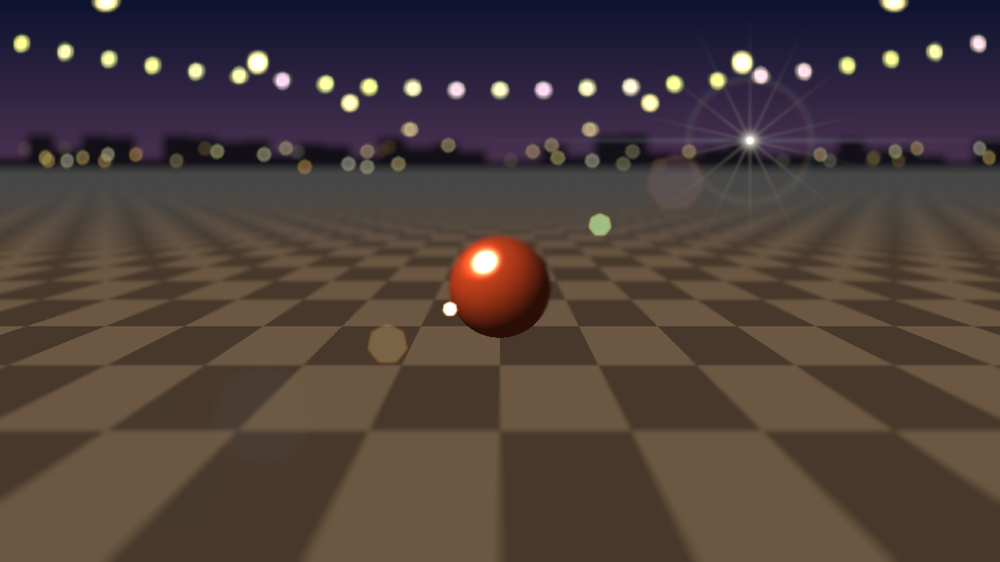
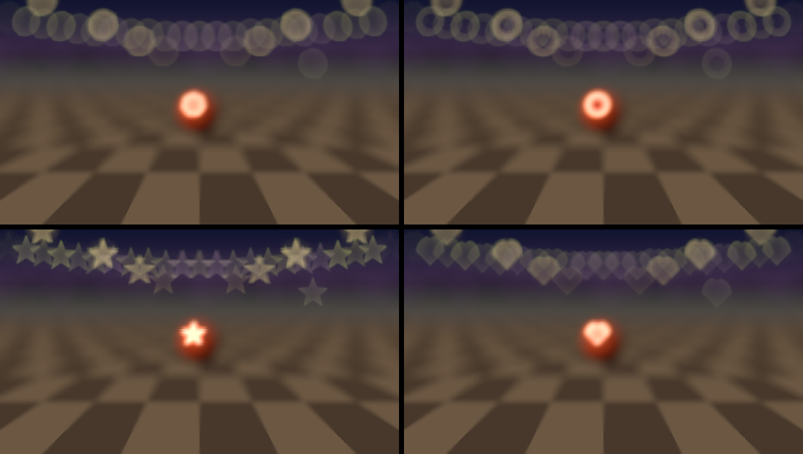

# Hyacinth user guide

Hyacinth is **shallow depth of field, bokeh and lens flare for [Resolume](https://resolume.com)
Arena and Avenue**: one FFGL effect, **SW Hyacinth**. It gives every pixel of your clip a depth,
focuses a lens at one distance and lets the rest of the picture fall out of focus, the way a fast
lens does. The highlights in the out-of-focus parts turn into the aperture's shape: seven-bladed
discs, a mirror lens's rings, stars or hearts. Or leave the picture sharp and add only the bokeh.
On top of either you can have floating orbs, lens flare and dirt on the glass, all drawn with the
same aperture.

Your clip doesn't come with a depth, so Hyacinth makes one up. It can be a floor running away to a
horizon, distance from a point, brightness, haze, or "whatever looks like the thing I'm focused
on". Or you can give it a real depth map, packed beside the picture. Focus can sit at a set
distance, at a point you pick, or on something the tracker follows round the frame.

The name is a long way round: Hyacinth Bucket insisted it was pronounced "Bouquet", and bouquet is
nearly bokeh.



*Rendered by `hytest`, the offline harness, not captured from Resolume. Its own test street, the
focus on the ball, a flare from one light, and the defaults otherwise.*

> **Before you rely on this:** it's at **v0.1.0** and very early days, and **not released yet**:
> there's no download, only the source. Its behaviour is measured rather than asserted, by a
> harness (`hytest`) that drives the plugin's own code in a headless GL context on one Apple
> Silicon Mac (macOS 26), at 1280×720 and 320×180 and again on Apple's software renderer. A
> defocused point's disc is the size a thin lens says, to 0.03 px. It carries its highlight's
> light to within 0.4 %, whatever the aperture's shape. The blade corners point where the blades
> are, upside down in front of focus. A ground plane's depth matches a pinhole camera's to three
> parts in ten million. The tracker follows a moving subject to 0.06 px. At zero Mix the clip
> comes through bit for bit. Sixteen models that are wrong on purpose and 21 one-character changes
> to the shipped code are all caught, and all 42 controls measurably change the picture.
> It's **never been loaded into Resolume**, on macOS or Windows. The one host it has run in is the
> fleet's own test host, `oxbow`, on a Mac, for 120 frames. Nobody has held it up next to a real
> lens's picture yet. Try it on a spare layer before you put it in a show.
>
> This codebase was created with AI assistance, directed and reviewed by a human author.

---

## Installing

**There's no download yet.** v0.1.0 hasn't been released, so for now Hyacinth is
[source on GitHub](https://github.com/stoatworks-labs/hyacinth) that you build yourself (the README
says how, on macOS). When it's released, each download will carry one effect, **SW Hyacinth**
(`Hyacinth.bundle` on macOS, `Hyacinth.dll` on Windows), to drop into Resolume's effects folder
before restarting Resolume:

```
macOS    ~/Documents/Resolume Arena/Extra Effects/
Windows  %USERPROFILE%\Documents\Resolume Arena\Extra Effects\
```

Avenue uses the same layout under its own folder name. The effect then shows up in the effects
browser as **SW Hyacinth**.

---

## Start here

1. Put **SW Hyacinth** on a clip. Something shot over a floor, a road or a stage is best to begin
   with, because the default depth is a ground plane.
2. Out of the box the ground is sharp a little below the middle of the frame and goes soft in
   front and behind, and the bright spots in the soft parts become seven-bladed discs.
3. Drag **Focus Y** up and down. The sharp band follows it, easing into place over a fifth of a
   second.
4. Turn **Blur Size** up for a faster lens, down for a slower one.
5. Change **Show** to **Depth** to see the depth it's using (white near, the focused distance
   marked), then back to **Picture**.
6. Change **Mode** to **Bokeh Only**: the picture comes back sharp and only the bokeh discs stay.

If the picture doesn't seem to change at all, the clip may have no bright spots and no depth
worth blurring at these settings: see [If it looks wrong](#if-it-looks-wrong).

---

## How the blur is made

A lens focused at one distance blurs a point at another into a disc, the **circle of confusion**.
Its radius isn't proportional to how far the point is from the focused distance. It's proportional
to the difference in their **nearness**, 1 over the distance. So Hyacinth keeps every depth as
nearness, from 1 (the nearest thing in the scene) to 0 (infinity), and the blur is

    radius = Blur Size × (nearness − the focused nearness)

Most of what you'll see falls out of that:

- **The background's blur levels off, the foreground's doesn't.** Twice the focus distance away, a
  point already has half the blur it will have at infinity. Nearer than focus, the blur keeps
  growing, so a hand in front of the lens is a smear.
- **A defocused highlight is the aperture,** with the highlight's light spread over it. A big disc
  is dim and a small one bright, so the total light stays the same.
- **In front of focus the aperture is upside down.** A heart is the wrong way up, and a seven-bladed
  disc points down instead of up.
- **Towards the corners a disc becomes a cat's eye,** clipped by the lens barrel.
- **A sharp thing hides the blur behind it, but a blurred thing in front spreads over a sharp
  one,** as with a real lens.
- **Colour fringes swap sides across focus:** magenta rims in front, green behind.

Video clips everything at white, so the bright spots in a clip have lost most of their light.
Hyacinth puts some back (**Highlights**) before it blurs, or a streetlight would defocus into a
grey smudge rather than a bright disc. Everything is worked out in linear light, then encoded for
the screen.

---

## The Lens group

**Mode** is **Depth of Field** (the picture defocused by depth, its highlights as bokeh) or
**Bokeh Only** (the picture left sharp, with its highlights' bokeh drawn over it). Bokeh Only is
the "sparkle without the blur" setting: the depth and focus still decide how big each highlight's
disc is.

**Blur Size** is how fast the lens is: the disc's radius for the biggest nearness difference there
can be, from 0 to 8 % of the frame's height. The default is 3 %.

---

## The Depth group

**Depth From** picks where the depth comes from:

- **Plane**: a flat surface running away to a horizon, such as a floor, a road, a table top or a
  wall. **Plane Angle** says which way it comes towards you (270°, the default, is the ground,
  nearer at the bottom of the frame; 90° is a ceiling, 0° a wall nearer on the right).
  **Horizon** says where it reaches infinity, from the frame's far edge (0) to its near edge (1).
  The default puts it three tenths of the way down from the top.
- **Radial**: nearest at the focus point and receding all round it, reaching infinity at
  **Radius** (0.1 to 3 frame heights). It suits a subject in the middle.
- **Luma**: bright is near. Turn on **Depth Invert** for bright is far, which suits a lit stage
  against a dark backdrop the other way round.
- **Haze**: haze and fog thicken with distance, so the hazier a part of the picture looks, the
  farther away it's taken to be. It suits landscapes, smoke and fog.
- **Subject**: whatever looks like the thing at the focus point is near, and the rest is far. "Looks
  like" is by colour, so it works best when the subject's colours differ from what's round it. Put
  **Focus X** and **Focus Y** on it, and set **Track Size** to about its size.
- **Clip Alpha**: the clip's alpha is the depth, white near.
- **Side by Side** and **Over Under**: the clip is a picture and a depth map packed together, the
  picture on the left or top and the depth (white near) on the right or bottom. A depth map made
  elsewhere, for example by running a depth-estimation model over the clip beforehand, beats every
  estimate above. The output is the picture half, stretched to fill the frame.

**Depth Edges** snaps an estimated depth (Haze and Subject) to the picture's own edges, so the blur
stops where the subject stops rather than in a soft halo round it. It's a radius, 0.5 to 8 % of
the frame's height (2.5 % by default). Bigger smooths the depth more but follows fine edges less.

**Depth Invert** swaps near and far, for any source.

---

## The Focus group

**Focus** picks what's sharp:

- **Manual**: the nearness in **Focus Depth**, 0 (infinity) to 1 (the nearest thing).
- **Point** (the default): the depth at **Focus X**, **Focus Y**, so you focus by pointing.
- **Track**: the depth of whatever was at the focus point when tracking started, followed as it
  moves round the frame.

**Track** grabs what's under the focus point when you switch to it, when you move Focus X or Y,
and when you press **Grab**. **Track Size** is the size of the patch it follows, 4 to 40 % of the
frame's height (15 % by default): about the size of the subject is right. Set **Show** to
**Tracker** to see the box: green while it's sure, amber when it's less sure, red when it has lost
the subject and is holding still. Press **Grab** to start again.

**Focus Speed** is how long a focus pull takes to settle, from instant to two seconds. It eases in
the way a focus puller's hand does, quickly at first then slowing (an exponential with that time
constant), so automating Focus Depth or moving the focus point gives a pull, not a jump. The
default is a fifth of a second. It runs on wall-clock time, whatever the frame rate.

---

## The Aperture group

**Shape** is the aperture a defocused highlight takes:

- **Iris**: **Blades** straight-edged blades (3 to 12, seven by default), rounded by **Blade
  Curve** (0 is straight, 1 a circle), turned by **Iris Rotate**.
- **Mirror**: a mirror lens's ring. The secondary mirror blocks the middle, so every highlight is a
  doughnut.
- **Star** and **Heart**: a cut-out in front of the lens.



*Shape: Iris (seven blades), Mirror, Star and Heart, everything out of focus. Rendered by
`hytest`.*

Then the lens's faults, which are what make bokeh look like a real lens's:

- **Cat Eye**: the barrel's shadow. Towards the corners the discs are clipped into a cat's eye; at
  1 a corner's disc is cut to half its width.
- **Swirl**: field curvature. The corner discs narrow towards the centre, so the background seems
  to swirl round the subject. At 1 a corner's disc is 40 % narrower one way than the other.
- **Squeeze**: an anamorphic lens's tall ovals, 1 (round) to 2 times as tall as wide.
- **Bubble**: spherical aberration, −1 to +1. Positive brightens the rim of the discs behind focus
  (the "soap bubble" look) and the middle of the ones in front; negative does the opposite. It
  moves light within a disc, never adds or takes it away.
- **Onion Rings**: the fine concentric rings polished aspheric elements leave in a disc. They only
  show on discs big enough to draw them.
- **Fringe**: chromatic aberration. Red and blue focus at a slightly different distance from green,
  so the discs grow magenta rims in front of focus and green ones behind.

---

## The Highlights group

**Highlights** is how much brighter than white the brightest parts of the scene really were, a gain
from 0 to 32 (8 by default). Video stores a streetlight and a white shirt at the same value, so
without this the light would defocus into a dull smudge. Turn it up for brighter, more distinct
discs; down to 0 for no added light at all.

**Threshold** is where a highlight starts, as a code value (0.75 by default). Above it the light is
put back and drawn as aperture-shaped discs; below it the picture is just blurred. Lower picks up
more of the picture as highlights, higher keeps only the brightest. Brightness is the brightest of
the three channels, so a red lamp counts as a light.

---

## The Orbs group

Orbs are lights that aren't in the picture: out-of-focus lights far behind the subject, scattered
across the frame and drifting. **Orbs** is how bright they are (0, off, by default), **Orb Count**
how many (0 to 400), **Orb Size** their radius (1 to 15 % of the height) and **Orb Drift** how fast
they move (up to 0.2 frame heights a second). Each takes its colour from the picture where it is,
and they twinkle slightly.

Orbs sit at infinity, so a sharp subject in front hides them, and their size is their own rather
than Blur Size's, so they stay as you set them while the focus moves.

---

## The Flare group

**Flare** turns the lens flare up from 0 (off, by default). **Flare From** says what the light is:

- **Highlights**: every bright, compact spot in the picture.
- **Light**: one light at **Light X**, **Light Y** that the picture doesn't have, such as the sun
  just out of frame.
- **Tracked**: that same light, stuck to whatever the tracker is following.

Then the parts of it:

- **Ghosts**: reflections between the lens's surfaces, in the aperture's shape, on the line from the
  light through the middle of the frame. They move the opposite way to the light.
- **Halo**: a ring round the light.
- **Starburst**: spikes off the light, one along each blade edge's normal. Six blades give six
  spikes, seven give fourteen, and a round aperture gives none.
- **Streak**: an anamorphic lens's horizontal line through the light.
- **Dirt**: specks and smudges on the front element, which only show where light falls on them.

The flare's geometry is physics: where the ghosts lie, their shape and the spike count. How bright
each part is, is taste.

---

## The Output group

**Show** is **Picture** (the effect), **Depth** (nearness as grey, white near, with the focused
distance marked in orange), **Blur** (the circle of confusion: green where it's sharp, red in front
of focus and blue behind, brighter for more blur) or **Tracker** (the picture, with the tracker's
box and the focus point). Depth and
Blur are the quickest way to find out why something is or isn't sharp.

**Mix** fades between the clip and the effect. At 0 the clip comes through untouched.

---

## Recipes

**A portrait over a stage.** Depth From **Plane**, Focus **Point** on the performer's feet, Blur
Size about halfway. The stage behind them goes soft and the lights become discs.

**A face in the middle.** Depth From **Radial**, Focus **Point** on the face, Radius about 0.5. Or
Depth From **Subject** with Focus X and Y on the face and Track Size about its size, if its colours
stand out.

**Follow a performer.** Focus **Track**, the focus point on them, Track Size about their size.
Check it with Show **Tracker**, and press **Grab** if the box wanders off.

**Sparkle on a concert shot.** Mode **Bokeh Only**, Blur Size at its top, Highlights up, Threshold
down a little. Everything stays sharp and the lights grow discs.

**A dreamy background.** Shape **Iris**, Blade Curve 1 (round), Bubble at about +0.8, Cat Eye at
about 0.6 and Swirl at about 0.5.

**Anamorphic.** Squeeze 2, Flare up, Streak up, Flare From **Highlights**.

**The sun off frame.** Flare From **Light**, Light X and Y just outside a corner, Ghosts and Halo up,
a little Dirt.

**A rack focus.** Focus **Manual** and Focus Speed about 1 s, then switch Focus Depth between two
values on a cue: the focus eases from one to the other.

---

## Performance

Measured on an Apple M4 Max with the plugin's own bench (`hytest --bench`), the median GPU time a
frame:

| | 720p | 1080p | 4K |
|---|---|---|---|
| the defaults (Plane, Point) | 1.08 ms | 1.54 ms | 3.67 ms |
| Bokeh Only, Blur Size at its top | 0.64 ms | 1.16 ms | 2.10 ms |
| Subject, Track, Blur Size at its top | 1.56 ms | 2.36 ms | 5.41 ms |
| Haze, flare, dirt, 400 orbs | 1.31 ms | 2.80 ms | 7.27 ms |

Haze and Subject cost more than Plane or Radial, because they work the depth out of the picture
each frame. Nothing here has been timed on Windows, or on a smaller GPU than this one.

---

## If it looks wrong

**Nothing seems to change.** Check **Mix** isn't at 0 and **Blur Size** isn't at 0. Look at Show
**Blur**: if it's all green, everything is in focus, so move the focus or change Depth From.

**The wrong thing is sharp.** Look at Show **Depth**. The estimate may simply be wrong for this
picture: try another Depth From, or **Depth Invert**.

**A halo of blur round the subject's edges.** Turn **Depth Edges** down for Subject or Haze, or use
a real depth map packed Side by Side.

**No bokeh discs, only blur.** The clip has no highlights above **Threshold**. Lower it, or turn
**Highlights** up.

**The whole picture turns into discs.** Threshold is too low. Raise it.

**The tracker loses the subject.** It follows sliding movement only, not turning or growing, so a
subject that turns or comes towards the camera can lose it. Make **Track Size** about the
subject's size and press **Grab** again. A patch with little texture is hard to follow.

**Half the picture, stretched across the frame.** Depth From is Side by Side or Over Under, which
expect a clip packed with its depth map. For an ordinary clip, use another source.

**Onion Rings does nothing.** The discs are too small to draw the rings. Turn Blur Size up.

---

## Known limits

- **The depth is a guess** unless you supply one. Plane and Radial are exact for the scenes they
  describe; Luma, Haze and Subject are only as right as their assumptions about the picture. There's
  no built-in depth-estimation model.
- **Detail finer than about 4 pixels** is softened in an estimated depth.
- **The tracker follows sliding movement only,** and has only been checked on synthetic pictures:
  nothing has checked it on a subject that turns, grows or is hidden.
- **Side by Side and Over Under output the picture half,** stretched to the frame, and at Mix 0 that
  stretched half is what comes through, not the packed clip.
- **No presets.** The recipes above are the nearest thing. No browser demo yet either.
- **Never loaded into Resolume**, and not compared against a real lens's picture.

---

## About

The last group, **About**, has the plugin's name, version, licence and maker, and buttons that open
this user guide, the project page, the source on GitHub and the support page in your browser.

## Reporting something

If something's wrong, shout at
[github.com/stoatworks-labs/hyacinth/issues](https://github.com/stoatworks-labs/hyacinth/issues). A
screenshot, the controls you changed, and the composition's resolution are usually enough. If the
effect drew nothing, attach the log:

```
macOS    ~/Library/Logs/hyacinth/hyacinth.YYYY-MM-DD.log
Windows  %LOCALAPPDATA%\hyacinth\logs\hyacinth.YYYY-MM-DD.log
```
